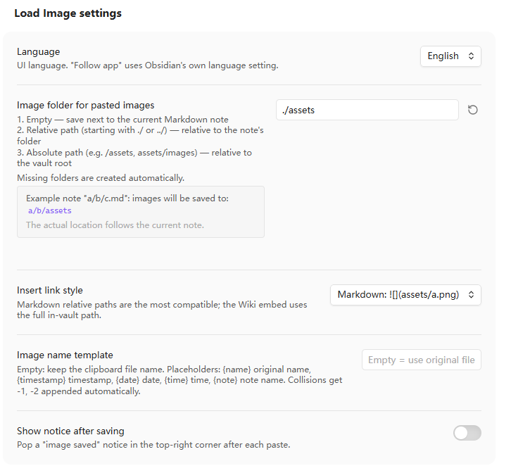

# Load Image

**English** | [简体中文](README.zh-CN.md)

[](https://github.com/njuptlzf/obsidian-load-image/releases)
[](LICENSE)
[](https://www.npmjs.com/package/@njuptlzf/obsidian-load-image)

Paste an image with `Ctrl/Cmd+V` and decide **exactly where it lands** — next to the note, in a `./assets` folder beside it, or in a shared `/assets/images` folder at the vault root. Missing folders are created for you, and existing files are never overwritten.



## Why

Obsidian's default is all-or-nothing: either everything goes into one global attachment folder, or images land next to the note. If you organize notes in folders, you usually want something in between — screenshots in a per-folder `assets`, diagrams in a shared `assets/images`, and so on.

Load Image takes over the paste **only when the clipboard actually contains an image**, so text and file pasting keep their native behavior.

## Features

- **Configurable destination** — empty = next to the note, `./` or `../` = relative to the note, anything else = relative to the vault root.
- **Folders are created automatically** — missing parent folders are added level by level.
- **Never overwrites** — a colliding name gets a `-1`, `-2` suffix instead.
- **Paste several images at once** — all are saved and inserted on separate lines.
- **Two link styles** — Markdown `` or Wiki embed `![[assets/a.png]]`.
- **Image name template** — empty keeps the original clipboard name; supports `{name}`, `{timestamp}`, `{date}`, `{time}`, `{note}`.
- **Bilingual UI** — the *Language* setting offers *Follow app* (uses Obsidian's own language), English and 中文. Settings, notices and the command name all follow it.

## Folder rules

How the *Image folder for pasted images* value is interpreted, for an example note at `notes/daily/2026-11-12.md`:

| Setting value | Where the image is saved |
| --- | --- |
| *(empty)* | `notes/daily/` (next to the note) |
| `./assets` (default) | `notes/daily/assets/` |
| `../assets` | `notes/assets/` |
| `./img/pasted` | `notes/daily/img/pasted/` |
| `/assets` | `assets/` (vault root) |
| `assets/images` | `assets/images/` (vault root) |

Rules behind it:

- A value starting with `./` or `../` is resolved **relative to the note's folder**.
- A value starting with `/`, or with no prefix at all, is resolved **relative to the Obsidian vault root**.
- So a folder beside the note must be written `./xxx`; plain `xxx` goes to the vault root. Keeping the two forms distinct means no ambiguity.
- Paths cannot escape the vault root (e.g. `../x` from the root raises an error).
- The settings page previews the resolved location live, using the fixed example note `a/b/c.md` so the preview stays short.

## Install

### Manual

1. Download `main.js`, `manifest.json` and `styles.css` from the [latest release](https://github.com/njuptlzf/obsidian-load-image/releases/latest).
2. Put them in `<your vault>/.obsidian/plugins/load-image/`.
3. Enable **Load Image** under *Settings → Community plugins*.

### From npm

```bash
cd <your vault>/.obsidian/plugins
mkdir -p load-image && cd load-image
npm init -y && npm i @njuptlzf/obsidian-load-image
cp node_modules/@njuptlzf/obsidian-load-image/{main.js,manifest.json,styles.css} .
```

### From source

```bash
npm install
npm run build      # produces main.js
npm run dev        # watch mode
```

## Settings

| Setting | Default | Description |
| --- | --- | --- |
| Language | Follow app | *Follow app* inherits Obsidian's language; or force English / 中文 |
| Image folder for pasted images | `./assets` | See [folder rules](#folder-rules); previewed live in settings |
| Insert link style | Markdown | `` or `![[assets/a.png]]` |
| Image name template | *(empty)* | Empty = keep the clipboard file name. Supports `{name}` `{timestamp}` `{date}` `{time}` `{note}`; illegal characters become `-`, collisions get `-1` |
| Show notice after saving | Off | Pop a short "image saved" notice in the top-right corner |

## Commands

- **Paste image from clipboard** — for binding a hotkey. Plain `Ctrl/Cmd+V` already works; this command covers edge cases where the `editor-paste` event does not fire.

## Development

```bash
npm run typecheck   # tsc --noEmit
npm run test        # vitest, 68 unit tests
npm run smoke       # loads the real main.js and simulates a full Ctrl+V paste
npm run verify      # all of the above + production build
```

Code layout:

- `main.ts` — controller: event registration, settings tab, adapts the Obsidian API to `VaultPort`.
- `src/paths.ts` — pure path resolution, unique naming, link building (no Obsidian dependency, easy to test).
- `src/saver.ts` — service layer: folder creation, writing, link assembly; depends only on the `VaultPort` interface.
- `src/settings.ts` — settings contract and defensive normalization.
- `src/i18n.ts` — en/zh dictionaries, `t()`, locale detection (the app language is passed in by the plugin).

## Releasing

Bump the version in `manifest.json`, `versions.json` and `package.json`, then push a tag that is **exactly** the version:

```bash
git tag 1.1.2 && git push origin 1.1.2
```

No `v` prefix. Obsidian matches the release tag against `manifest.json` literally, so `v1.1.2` is reported as *"no GitHub release with that version has been published yet"*. The release workflow builds the plugin, attaches `main.js` / `manifest.json` / `styles.css`, signs them with a build provenance attestation, and fails early when the tag and the manifest version diverge.

`versions.json` is committed to the repository but **not** attached to the release: Obsidian reads it from the repository, and the plugin review rejects a release that carries extra files.

## License

MIT
